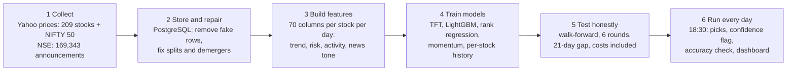

# AlphaEdge: Ranking Indian Stocks with Machine Learning

Every trading day, AlphaEdge ranks 209 large Indian (NSE) stocks and picks the **20 most likely to beat the average stock over the next month (21 trading days)**. It also flags the days when its models agree strongly enough to deserve more trust.

Behind that one daily list are six years of collected and repaired market data, 169,343 company announcements scored for tone, eight model versions tested on 18 months of data they never saw, and a pipeline that runs, checks its own accuracy and retrains by itself.

This is our Data Science and Machine Learning end-semester project.

**Team:** Uzair Manjre\* · Pal Gandhi · Malav Thakor · Shlok Barot (\*corresponding author)

> Not financial advice. This is a student research project; past test results do not guarantee future returns.

---

## Contents

- [Results](#results)
- [Quick start (Windows)](#quick-start-windows)
- [Using it day to day](#using-it-day-to-day)
- [Downloads (GitHub Releases)](#downloads-github-releases)
- [How it works](#how-it-works)
- [Project layout](#project-layout)
- [Retraining and re-running the experiments](#retraining-and-re-running-the-experiments)
- [Manual setup (macOS, Linux or your own PostgreSQL)](#manual-setup-macos-linux-or-your-own-postgresql)
- [Troubleshooting](#troubleshooting)
- [Report and paper](#report-and-paper)
- [Limitations](#limitations)

---

## Results

Tested walk-forward: six rounds of three months each, late March 2025 to September 2026 (378 trading days). Each model was trained only on data from before each round, with a 21-day gap so no future information leaks in.

**The three headline numbers**

| What we measured | Result |
|---|---|
| Forecast ranges (the model's 10th–90th percentile band) contained the real return | **80–83%** of the time (the target is 80%) |
| Top 20 grew more than the NIFTY 50 over the next 21 days, **high-confidence days** (48% of days) | **74%** of days |
| Top 20 grew more than the NIFTY 50 over the next 21 days, **all days** | **68%** of days |

**Read these with one fact in mind.** Over this period the *average* stock beat the NIFTY 50 on 63% of days, because mid-sized companies did well. So the honest measure of skill is our picks against the average stock, where a coin toss scores 50%: **65% on all days and 70% on high-confidence days.**

**Each model on its own (21-day horizon)**

| Model | IC | t-stat | Top 20 beat the average stock | Top 20 beat the NIFTY 50 |
|---|---|---|---|---|
| Momentum 12-1 (a fixed rule, nothing trained) | 0.052 | 2.22 | 59.9% | 66.3% |
| LightGBM median forecast | 0.041 | 0.74 | 58.1% | 67.4% |
| Per-stock history | 0.020 | 0.86 | 44.6% | 54.9% |
| Rank regression | 0.017 | 0.69 | 41.9% | 53.1% |
| LambdaRank | −0.027 | −1.42 | 41.9% | 49.1% |
| **Final blend (smoothed)** | **0.057** | **1.85** | **65.0%** | **68.4%** |

- **IC (information coefficient):** the rank correlation between a model's scores and the returns that followed, averaged over days. 0 means no skill.
- **t-stat:** how sure we can be that the average IC is not luck. Above about 2 is convincing.
- **Combining helps more than picking one model:** at the 5-day horizon, an equal-weight average of four models has a t-stat of 3.02, while the best single model reaches 2.20.

**What did not work, and we report it anyway**

- **Predicting up or down is no better than a coin toss.** Whether a single stock beats the index scores 50–52%, which is why the project ranks stocks instead.
- **Hyperparameter tuning overfit.** The IC was 0.059 during tuning and 0.009 on the test. A second, stricter tuning run was rejected by a rule we set before seeing the test.
- **The Temporal Fusion Transformer (TFT) neural network collapsed to flat forecasts** until we found the cause (weight decay). Without weight decay, it overfit. It is still used for the 5-day forecast ranges.

---

## Quick start (Windows)

You need Windows 10/11 (64-bit), [Python 3.10](https://www.python.org/downloads/release/python-31011/) (3.11 and 3.12 also work; tick "Add python.exe to PATH" when installing), [Git](https://git-scm.com/download/win), an internet connection and about 6 GB of free disk. No admin rights and no Docker are needed.

```powershell
git clone https://github.com/UzairManjre/stock_predict.git C:\stock_predict
cd C:\stock_predict
.\setup.bat
```

(Or download the ZIP from GitHub, unzip it to a short path such as `C:\stock_predict`, and double-click **`setup.bat`**.)

`setup.bat` runs [`setup.ps1`](setup.ps1), which does everything below and skips any step already done, so it is safe to run again:

| Step | What happens | Download |
|---|---|---|
| 1 | Creates `.env` with the database settings, copied from [`.env.example`](.env.example) | none |
| 2 | Creates `venv\` and installs PyTorch (the CUDA build if an NVIDIA GPU is found, otherwise the CPU build), then [`requirements.txt`](requirements.txt) | about 2.5 GB (GPU) or 1 GB (CPU) |
| 3 | Downloads the data, the trained model and the database snapshot from this repository's [Releases](https://github.com/UzairManjre/stock_predict/releases), checks each SHA-256 and unpacks them | 263 MB |
| 4 | Installs a portable PostgreSQL 16 in `.\postgres` (no Windows service), starts it on port 5433 and restores the database | 322 MB |
| 5 | Runs [`verify_setup.py`](verify_setup.py), which checks everything and prints today's top 20 picks | none |

Setup takes about 10–20 minutes, mostly downloads. When it finishes, start the dashboard:

```powershell
.\start_dashboard.bat        # opens http://localhost:8501
```

**Setup options:** `setup.bat -CpuOnly` (force the CPU build of PyTorch) · `-AllModels` (also download every trained checkpoint, 1.3 GB) · `-Port 5440` (another PostgreSQL port for a new install) · `-SkipPython` / `-SkipData` / `-SkipDatabase` / `-SkipVerify`.

---

## Using it day to day

| Task | Command (from the project folder) |
|---|---|
| Open the dashboard | `start_dashboard.bat` |
| Today's top 20 and confidence flag (reads files only, writes nothing) | `venv\Scripts\python.exe Cleaner\final_model.py --score` |
| Run the full daily update now | `venv\Scripts\python.exe run_live_tracking.py` |
| Run the daily update every weekday at 18:30 | `powershell -ExecutionPolicy Bypass -File setup_live_tracking.ps1` |
| Live hit rates of past picks | `venv\Scripts\python.exe Cleaner\accuracy_checker.py --report-only` |
| Check the setup again | `venv\Scripts\python.exe verify_setup.py` |
| Start or stop the database (it does not start after a reboot) | `db_start.bat` / `db_stop.bat` |

**The dashboard** has seven pages: Overview, Top Picks, Stock Deep Dive, Sector Analysis, News & Sentiment, Accuracy (live hit rates) and Pipeline Status.

**The daily update** ([`run_live_tracking.py`](run_live_tracking.py) → [`run_daily_update.py`](run_daily_update.py)) runs these steps in order, logging to `logs\daily_<date>.log`:

1. Starts PostgreSQL.
2. Downloads the latest prices from Yahoo Finance and repairs known data errors.
3. Rebuilds the features.
4. Retrains the models if they are 15 days old or more.
5. Writes new forecasts, the top 20 and the confidence flag to the database.
6. Scores every past forecast whose 5- or 21-day horizon has ended.

> **First run on a new PC:** the downloaded model is dated 16 Oct 2026, so the first daily update will retrain it. That takes hours, especially without an NVIDIA GPU. To skip retraining, run `venv\Scripts\python.exe run_live_tracking.py --retrain-interval 9999`.

---

## Downloads (GitHub Releases)

Large files are not stored in git. They are attached to [Releases](https://github.com/UzairManjre/stock_predict/releases), and `setup.ps1` downloads and checks them for you. Each archive unpacks into the project folder with its paths already in place.

| Release | File | Size | Contents |
|---|---|---|---|
| [`data-2026-11-01`](https://github.com/UzairManjre/stock_predict/releases/tag/data-2026-11-01) | `stock_predict_data_2026-11-01.zip` | 255 MB | Features (310,540 rows × 70 columns), TFT dataset definition, registered TFT checkpoint (version 18), 169,343 NSE announcements with FinBERT tone, walk-forward test predictions, event-study events, legacy SQLite DB |
| [`db-2026-11-01`](https://github.com/UzairManjre/stock_predict/releases/tag/db-2026-11-01) | `stock_predict_2026-11-01.dump` | 8 MB | PostgreSQL snapshot (`pg_dump -Fc`): prices through 30 Oct 2026, companies, daily sentiment, 5,852 stored forecasts and 1,041 scored ones |
| [`models-2026-11-02`](https://github.com/UzairManjre/stock_predict/releases/tag/models-2026-11-02) | `stock_predict_models_2026-11-02.zip` | 1.3 GB | **Optional.** All 23 TFT checkpoints from 14 training runs with their logs, older Lightning logs, CatBoost log and MLflow runs |

The LightGBM models and the final blend are small text files, so they are in git under [`artifacts/`](artifacts/). The 2,793 results-filing PDFs (about 20 GB) are not uploaded; [`Scaper/download_filing_pdfs.py`](Scaper/download_filing_pdfs.py) downloads them again from NSE.

---

## How it works



**1. Data we collected**

- **Prices:** daily open, high, low, close and volume for 209 NIFTY-index stocks plus the NIFTY 50 index, 31 Aug 2020 to 30 Oct 2026 (312,064 rows), from Yahoo Finance ([`Cleaner/daily_fetch.py`](Cleaner/daily_fetch.py), [`Cleaner/fetch_nifty50.py`](Cleaner/fetch_nifty50.py)).
- **Company announcements:** 169,343 NSE filings with their one-line summaries ([`Scaper/fetch_filings_metadata.py`](Scaper/fetch_filings_metadata.py)), and 2,793 results PDFs ([`Scaper/download_filing_pdfs.py`](Scaper/download_filing_pdfs.py)).
- **Sector and industry** for every company.

**2. Cleaning** ([`Cleaner/clean_prices.py`](Cleaner/clean_prices.py), run after every price download)

Yahoo data has errors, so this step:

- deletes "bad prints": single rows that jump more than 50% and revert the next day;
- deletes zero-volume placeholder rows, and the fake rows Yahoo adds on exchange holidays;
- corrects corporate actions Yahoo got wrong: bonus issues applied on the wrong date (CONCOR, TRENT) and demergers (TATAMOTORS, VEDL);
- lists any remaining one-day move over 20% for a manual check.

Renamed tickers (TATAMOTORS → TMPV, LTIM → LTM) are mapped when downloading.

**3. Features** ([`Cleaner/build_features.py`](Cleaner/build_features.py))

The feature table has 70 columns per stock per day:

- **returns and momentum:** returns over 1 to 126 days, 10-day momentum and 12-1 month momentum;
- **technical indicators:** RSI, stochastic RSI, MACD, Bollinger width, and the price against its 50-day average and 52-week high;
- **risk:** 20- and 60-day volatility, ATR, volatility regime and beta;
- **trading activity:** volume spikes, OBV, PVT, illiquidity and size;
- **market and sector:** the stock's sector, plus sector and NIFTY 50 returns and volatility;
- **calendar:** day of week, month, quarter end and earnings week;
- **announcements:** the tone of announcements and how many were made.

Announcement summaries were scored with FinBERT ([`Cleaner/score_filing_summaries.py`](Cleaner/score_filing_summaries.py)). The tone fades over time, with a half-life of 1.5, 4 or 6 trading days depending on company size. The target is the **excess return over the NIFTY 50**.

**4. Models**

| Model | What it does | Code |
|---|---|---|
| Momentum 12-1 | The return from 12 months ago to 1 month ago. A fixed rule with nothing trained | [`Cleaner/final_model.py`](Cleaner/final_model.py) |
| Rank regression | LightGBM trained on each day's *ranks* of 33 features, to predict each stock's rank | [`Cleaner/ranking.py`](Cleaner/ranking.py) |
| LightGBM quantile | Forecasts the 10th, 50th and 90th percentile of the return; we use the median | [`Cleaner/train_lgbm.py`](Cleaner/train_lgbm.py) |
| Per-stock history | Each stock's typical (median) 21-day excess return in the past | [`Cleaner/final_model.py`](Cleaner/final_model.py) |
| Temporal Fusion Transformer | Attention-based neural network with a 60-day history; gives the 5-day forecast ranges | [`Cleaner/train_tft.py`](Cleaner/train_tft.py), [`Cleaner/predict.py`](Cleaner/predict.py) |

**5. Testing** ([`Cleaner/evaluate.py`](Cleaner/evaluate.py), [`Cleaner/ensemble_study.py`](Cleaner/ensemble_study.py), [`Cleaner/confidence_study.py`](Cleaner/confidence_study.py))

- Walk-forward test: six rounds of 63 trading days, each model retrained on all earlier data, with a 21-day gap.
- Trading costs of 0.18% per round trip are included.
- Tuning used only data from before the test period ([`Cleaner/tune_ranker.py`](Cleaner/tune_ranker.py)).

**6. The final model and the confidence flag** ([`Cleaner/final_model.py`](Cleaner/final_model.py), frozen 17 Oct 2026)

- **Blend:** each of the four members (momentum, rank regression, LightGBM, per-stock history) turns its scores into percentile ranks for the day. The blend is their plain average, smoothed over the last 5 days, and the top 20 are the picks.
- **High confidence:** a day counts as high-confidence when the four members agree more than usual. Agreement is the average rank correlation between each pair of members. The day must beat the median agreement of the previous 126 days.
- **Fixed in advance:** we set this rule before measuring how well it works.

---

## Project layout

```
stock_predict/
├── setup.bat / setup.ps1      one-command setup (see Quick start)
├── verify_setup.py            checks packages, database, files; prints today's picks
├── start_dashboard.bat        starts the database and the dashboard
├── run_live_tracking.py       one unattended daily run (used by Task Scheduler)
├── run_daily_update.py        the daily steps: fetch, clean, features, retrain if due, predict, score
├── setup_live_tracking.ps1    schedules the daily run for weekdays 18:30
├── db_start.bat / db_stop.bat start / stop the portable PostgreSQL
├── .env.example               database settings (copied to .env by setup)
├── requirements.txt           Python packages (Python 3.10)
├── schema.sql                 database schema
├── Cleaner/                   the main pipeline: data, cleaning, features, models, evaluation, live prediction
├── Scaper/                    scrapers: NSE announcements and PDFs, BSE announcements, market data
├── dashboard/app.py           Streamlit dashboard
├── artifacts/                 trained LightGBM and final-blend models, model registry, feature stats
├── training_data/             features (from the data release), best hyperparameters, backtest summary
├── results/                   outputs of every experiment (CSV, JSON, charts)
└── report/                    printed project report, research paper, and the report's build scripts
```

Created by setup and kept out of git: `venv/`, `postgres/`, `downloads/`, `.env`, plus the data files from the releases.

The root-level `get_*.py`, `patch_dashboard*.py`, `read_head.py`, `check_remaining.py`, `Cleaner/FINAL.PY`, `run_final.bat`, `indicator.md`, `model_training.md`, `Plan.docx` and `Module details.docx` are from the project's early stages. They are kept for the record but are not needed to run anything.

---

## Retraining and re-running the experiments

Start the database first (`db_start.bat`). Run every command from the project folder with `venv\Scripts\python.exe`.

| What | Command |
|---|---|
| Rebuild features from the database | `Cleaner\pipeline.py --stages features` |
| Retrain the TFT (GPU recommended) and refit the final blend | `Cleaner\pipeline.py --stages features train final` |
| Refit only the final 21-day blend (minutes) | `Cleaner\final_model.py --train` |
| Train the LightGBM quantile models | `Cleaner\train_lgbm.py` |
| Walk-forward test of all models | `Cleaner\evaluate.py --horizons 5 21 --save-predictions --out results\my_run` |
| Compare ensembles on the saved test predictions | `Cleaner\ensemble_study.py --dir results\my_run --horizon 21` |
| Confidence-flag study | `Cleaner\confidence_study.py` |
| Momentum hit rates since 2021 | `Cleaner\hit_rate_history.py` |
| Which kinds of announcement move prices | `Cleaner\event_study.py` |
| Re-score announcement tone with FinBERT (downloads the model from Hugging Face on first use) | `Cleaner\score_filing_summaries.py` |
| Download announcements again from NSE | `Scaper\fetch_filings_metadata.py --from-date 01-09-2020` |

The browser-based scrapers in `Scaper/` also need `venv\Scripts\python.exe -m playwright install chromium`.

Please do not re-tune models against the same test period. The tuning protocol in `tune_ranker.py` exists to keep the walk-forward test a one-shot, honest check.

---

## Manual setup (macOS, Linux or your own PostgreSQL)

`setup.ps1` is the tested path. On other systems, or with a PostgreSQL server you already run, do the same steps by hand (these steps are untested outside Windows):

```bash
git clone https://github.com/UzairManjre/stock_predict.git && cd stock_predict
python3.10 -m venv venv && source venv/bin/activate        # Windows: venv\Scripts\activate
pip install torch==2.5.1 --index-url https://download.pytorch.org/whl/cpu   # macOS: pip install torch==2.5.1
pip install -r requirements.txt

# Data and model files (paths inside the zip are relative to the project folder)
curl -LO https://github.com/UzairManjre/stock_predict/releases/download/data-2026-11-01/stock_predict_data_2026-11-01.zip
unzip stock_predict_data_2026-11-01.zip -d .

# Database: PostgreSQL 16 running anywhere you can reach
curl -LO https://github.com/UzairManjre/stock_predict/releases/download/db-2026-11-01/stock_predict_2026-11-01.dump
createdb -h localhost -p 5432 -U postgres stock_predict
pg_restore -h localhost -p 5432 -U postgres -d stock_predict --no-owner --no-privileges stock_predict_2026-11-01.dump

cp .env.example .env        # then set DB_PORT (5432 for a normal install) and DB_PASSWORD
python verify_setup.py
streamlit run dashboard/app.py
```

On macOS or Linux, run the daily update with `python run_daily_update.py`. `run_live_tracking.py` and the `.bat` files are for Windows only.

---

## Troubleshooting

| Problem | Fix |
|---|---|
| "running scripts is disabled on this system" | Use `setup.bat`, or run `powershell -ExecutionPolicy Bypass -File setup.ps1` |
| "the project folder path is N characters long" | Move the folder to a short path such as `C:\stock_predict` and run setup again |
| "Python 3.10, 3.11 or 3.12 was not found" | `winget install -e --id Python.Python.3.10`, or install it from python.org with "Add python.exe to PATH" ticked |
| A download stopped halfway | Run setup again. Files are checked by SHA-256 and downloaded again if damaged |
| Port 5433 is already in use | Delete `.env` and run `setup.bat -Port 5440` (before the database is created), or change `DB_PORT` in `.env` and `port` in `postgres\data\postgresql.conf` |
| Dashboard says it cannot connect to the database | Run `db_start.bat`. The database does not start by itself after a reboot |
| You want a fresh database | Run `db_stop.bat`, delete `postgres\data`, then run setup again |
| `verify_setup.py` reports missing files | Run setup again. It unpacks only missing files and never overwrites newer ones |
| News & Sentiment page says "No reports in the database" | Expected. The per-filing report text was lost with the original database. The announcement tone the models use is intact (in the features and the `daily_sentiment_aggregates` table) |
| You want the space back after setup | Delete the `downloads\` folder (about 0.6 GB; 1.9 GB with `-AllModels`) |

---

## Report and paper

The [`report/`](report/) folder has:

- **Project report** (printed submission, 20 pages): [`AlphaEdge_Project_Report.pdf`](report/AlphaEdge_Project_Report.pdf), with the [.docx](report/AlphaEdge_Project_Report.docx). It covers what we do, the data, cleaning, features, models, testing and the daily system.
- **Research paper:** [`Ranking_Not_Predicting_Research_Paper.pdf`](report/Ranking_Not_Predicting_Research_Paper.pdf), with the [.docx](report/Ranking_Not_Predicting_Research_Paper.docx).
- **Report build scripts:** [`report/source/`](report/source/) has the scripts that regenerate the report and its figures.

---

## Limitations

- **Survivorship bias:** the 209 stocks are today's index members, so companies that dropped out are missing. Past results look a little better than they really were.
- **Short test:** 18 months contain only about 18 independent monthly periods, so each hit rate has a standard error of about 11 percentage points.
- **One kind of market:** the test period favoured mid-sized companies. Results may differ in other conditions.
- **Patterns change:** what worked in 2020–2026 may stop working, which is why the system tracks its live accuracy every day.
